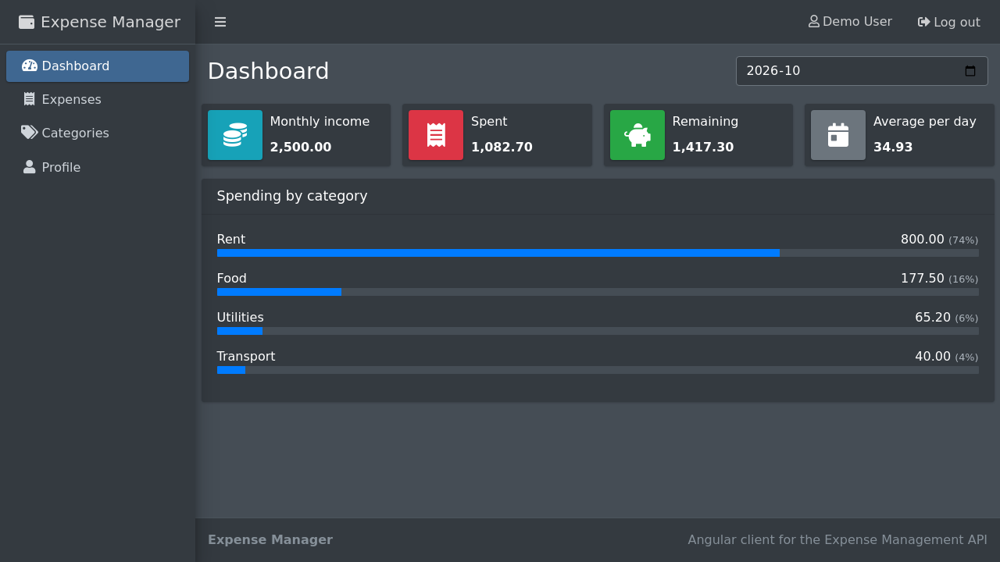
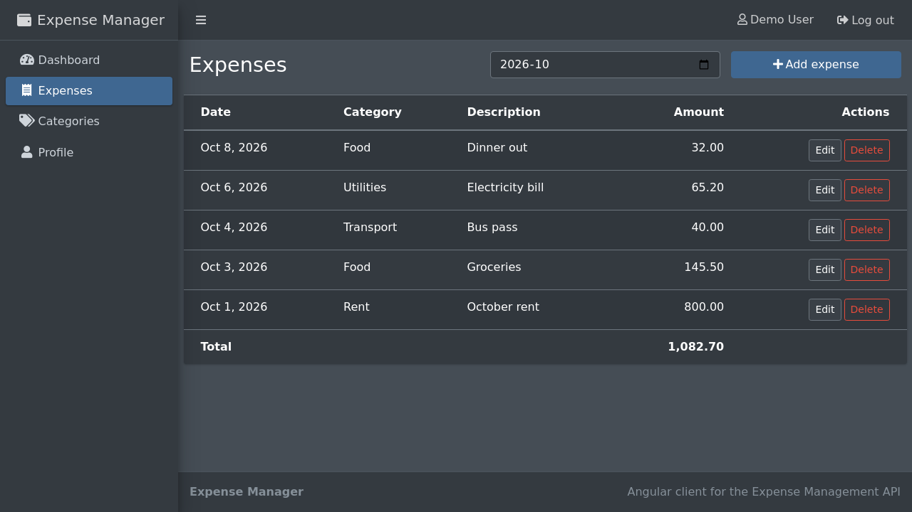
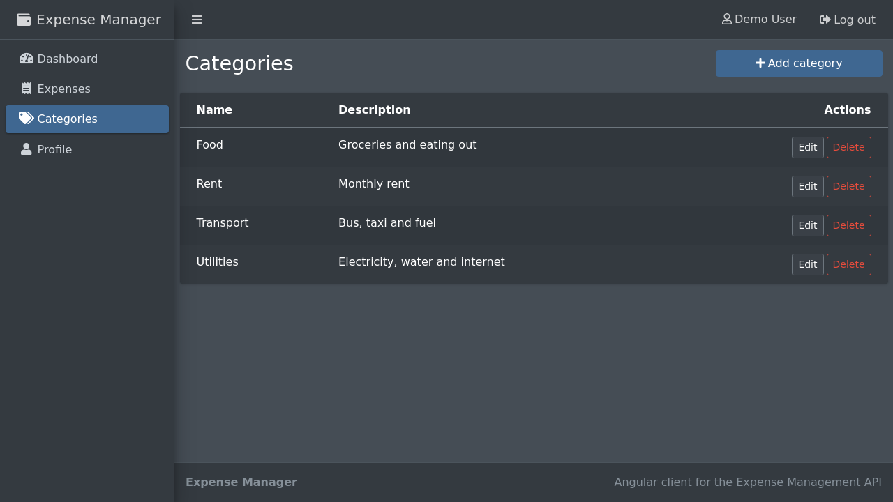
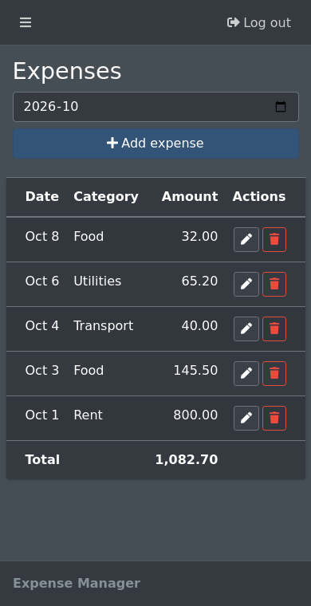

# Expense Management: Angular Client

Angular client for the [Expense Management API](https://github.com/belalyasin/expense-management-api). Track what you spend each month against your income.



## Features

- Register, sign in and sign out. The session token is sent with every request, and an expired session returns you to the sign-in page
- Dashboard for any month: income, amount spent, amount remaining, average per day, and spending by category
- Expenses: list, add, edit and delete, with a running total
- Categories: add, rename and delete. A category that still has expenses cannot be deleted
- Profile: account details and the monthly income setting
- Works on phones as well as desktops

| Expenses | Categories | Phone |
| --- | --- | --- |
|  |  |  |

## Tech stack

Angular 15, TypeScript, RxJS, reactive forms, AdminLTE 3 (Bootstrap 4), Sass

## Getting started

Start the [API](https://github.com/belalyasin/expense-management-api) first (it listens on port 3000 by default), then:

```bash
git clone https://github.com/belalyasin/expense-management-angular.git
cd expense-management-angular
npm install
npm start
```

Open http://localhost:4200 and create an account.

The API address is set in `src/environments/environment.ts` (`apiUrl`).

## Scripts

| Command | What it does |
| --- | --- |
| `npm start` | Development server with live reload |
| `npm run build` | Production build in `dist/expense-management` |
| `npm test` | Unit tests (Karma and Jasmine) |

## Project structure

```
src/app
  core/          services, route guards, HTTP interceptor, models
  layout/        shell of the signed-in area
  shared/        header, sidebar, footer, month picker
  modules/auth/  sign-in and registration pages
  dashboard/     monthly statistics
  expences/      expense list and form
  categories/    category list and form
  users/         profile page
```
